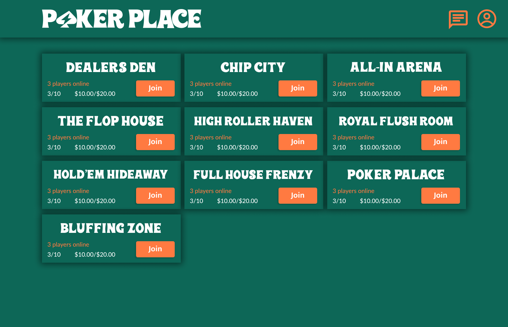
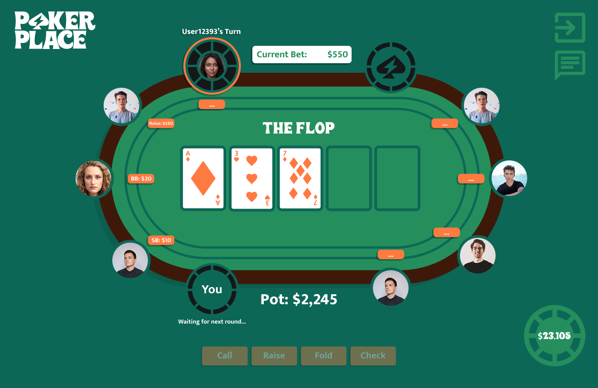

# ⚡ Lightning Poker ⚡🃏  
**Bitcoin Lightning Network No Limit Texas Hold'em Poker**

Play real-money cash games instantly using Bitcoin Lightning micropayments – no accounts, low fees, global players.



### Overview
Lightning Poker is a full-stack real-time multiplayer poker app powered by the Bitcoin Lightning Network. Players buy in with sats, play No Limit Texas Hold'em at cash tables, and cash out winnings instantly.

- **Key Features**:
  - Multi-table cash games (multiple stakes/players)
  - Instant Lightning buys/rebuys and cashouts
  - Real-time gameplay with WebSockets (betting, folding, showdowns)
  - Fair hand dealing and evaluation
  - Anonymous play (no sign-up required)

Built end-to-end by me – frontend public, backend private for security.

### Tech Stack
- **Frontend** (Public Repo): React + Socket.io for real-time updates  <!-- Update if different -->
- **Backend** (Private): Node.js/Scala for game server, concurrency, and Lightning integrations
- **Payments**: Bitcoin Lightning Network (invoices, webhooks, channel management)
- **Real-Time**: WebSockets/Socket.io
- **Game Logic**: Custom Texas Hold'em engine (hand ranking, pot management, betting rounds)
- **Infra**: Docker, scalable design for concurrent tables

**Note**: Backend code private to protect payment/security logic – high-level architecture and snippets available on request (highlights my Scala concurrency expertise from professional high-volume systems).

### Key Challenges Solved
Mirroring enterprise real-time transaction systems:

- **Real-time multiplayer concurrency**: Managed simultaneous actions across tables (betting races, timeouts) without conflicts – similar to handling 40–50k daily transactions with low latency (Event Dynamic GraphQL/WebSockets).
- **Secure & reliable Lightning payments**: Instant buys/rebuys with webhook confirmation, failure retries, and dispute-free cashouts – achieved near-100% reliability (like production micropayments in PolloFeed).
- **Fair game integrity**: Server-authoritative randomness, hand evaluation, and anti-collusion measures – ensured trust in real-money play.
- **Scalability for multiple tables**: Designed for concurrent games and player spikes – lessons applied to optimizing high-throughput SaaS (query tuning from 17s to <1s).

**Metrics/Traction**:
- Real Lightning payments processed in testing/production
- Community interest in Lightning gaming space (live site discussions on Reddit/Telegram)

This project showcases full-stack real-time development, transaction reliability, and game architecture

### Screenshots




### Running the Frontend Locally
```bash
npm install
npm start
```